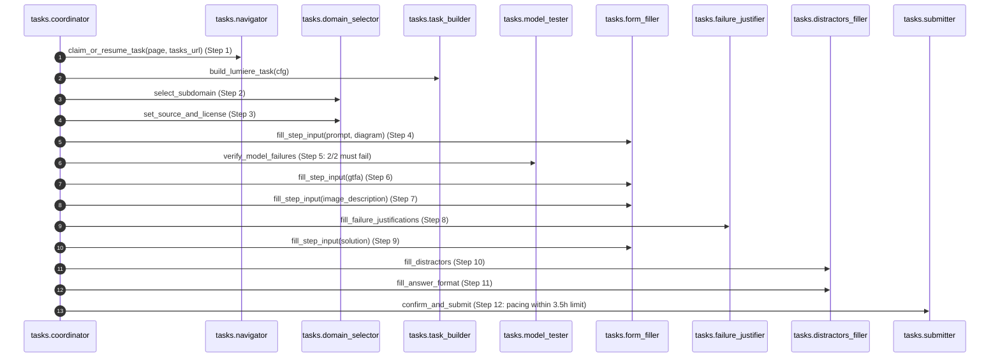

# Handshake AI Project Lumière Automation Architecture

Autonomous Playwright and Vision AI automation for authoring graduate-level engineering multimodal reasoning tasks on Handshake AI (`ai.joinhandshake.com`), conforming strictly to NASA JPL Rule 4 (≤ 60 lines per module).

---

## 1. Sequence Diagram

---

## 2. Modules (NASA JPL Rule 4 — ≤ 60 Lines Per File)

- `handshake_automation/config.py`: Environment configuration and typed Settings dataclass.
- `handshake_automation/instances.py`: Multi-instance configuration and dynamic loader.
- `handshake_automation/keep_awake.py`: Windows system sleep prevention assertion.
- `handshake_automation/browser.py`: Google Chrome CDP attachment (port 9222) and profile manager.
- `handshake_automation/main.py`: Autonomous execution supervisor loop and signal handling.
- `handshake_automation/tasks/navigator.py`: Task discovery, claiming, and timer modal activation.
- `handshake_automation/tasks/domain_selector.py`: Subdomain and Original / Online image license configuration.
- `handshake_automation/tasks/diagram_creator.py`: Self-authored engineering diagram generator using Matplotlib.
- `handshake_automation/tasks/task_builder.py`: Builds diagram and authors complete problem artifacts.
- `handshake_automation/tasks/curated_sources.py`: Verified Open-Access CC-BY engineering figures catalog.
- `handshake_automation/tasks/ai_author.py`: Lumière KaTeX graduate problem, GTFA, and distractor generator.
- `handshake_automation/tasks/key_pool.py`: Multi-key pool rotation and 429 quota cooldown manager.
- `handshake_automation/tasks/model_tester.py`: In-platform test model execution and 2/2 failure verification.
- `handshake_automation/tasks/failure_justifier.py`: Error type selection and KaTeX failure justifications.
- `handshake_automation/tasks/form_filler.py`: Input text and file upload handler.
- `handshake_automation/tasks/distractors_filler.py`: Step 10 distractors and Step 11 answer format selector.
- `handshake_automation/tasks/submitter.py`: Session pacing within 3.5h, time confirmation, and submission.
- `handshake_automation/tasks/coordinator.py`: Full orchestrator executing the 12 steps end-to-end.
